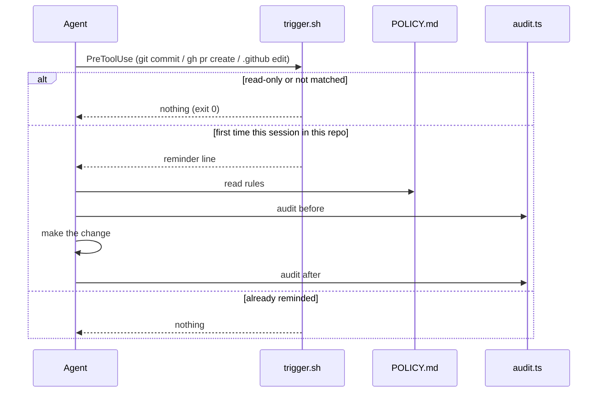

# App Flow: ci-flow

> [!NOTE]
> There is no app. The "journeys" are an agent's path through the hook, the policy and the audit, and the owner's path when creating or hardening a repo.

## 1. An agent is about to change state

Error and empty paths:
- No `jq` or unreadable input: no reminder (fails silent, never blocks).
- Target directory does not exist yet (a Write creating it): the nearest existing parent is used to find the repo.
- Not a git repo: the directory itself is the key.

## 2. Owner creates a repository

Moved to repo-create (`~/.claude/skills/repo-create/POLICY.md`; on GitHub: [kikearciniegas/repo-create](https://github.com/kikearciniegas/repo-create)): the pre-creation audit, creation and repository settings. Once the repo has CI, flow 3 applies.

## 3. Owner changes CI

The procedure in [`SKILL.md`](../skills/ci-flow/SKILL.md) ("Procedure for a CI change"): audit → worktree → draft PR → local tiers → mark ready once → required-check change by direction → audit again.

## 4. Going public

Moved to repo-create (`~/.claude/skills/repo-create/POLICY.md`; on GitHub: [kikearciniegas/repo-create](https://github.com/kikearciniegas/repo-create)).

## 5. A red CI run

Classify it (billing stop, runner infra, toolchain drift, real defect, OS-only), never rerun until green. See `SKILL.md` "Red runs" and `references/lessons.md`.
