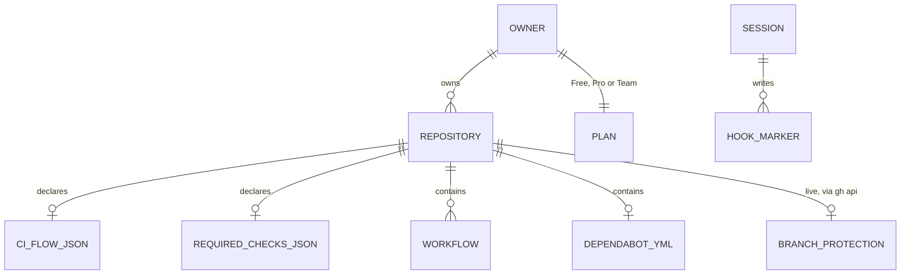

# Backend Schema: ci-flow

> [!NOTE]
> No database. The data model is the set of files and API objects the audit reads, and the few files the hook and owner keep locally.

## Entities

| Entity | Where it lives | Fields / shape | Identifier |
|---|---|---|---|
| `.github/ci-flow.json` | repo tree | `{"addons": [...]}`, values `gated-expensive`, `classifier`, `local-stamps`, `deploy`; absent = audited against the full design | path |
| `.github/required-checks.json` | repo tree | JSON array of CI job names | path |
| Workflow | `.github/workflows/*.yml` | parsed structurally (triggers, jobs, `if:`, `needs:`, pins) | file name |
| `dependabot.yml` | `.github/` | ecosystems, groups | path |
| Branch protection, dismissed Dependabot alerts, runs | GitHub, read by `gh api` GET | as the API returns them | `owner/name` |
| Private prefixes, plan, repository settings | moved to repo-create (`~/.claude/skills/repo-create/POLICY.md`; on GitHub: [kikearciniegas/repo-create](https://github.com/kikearciniegas/repo-create)) | | |
| Hook marker | `${TMPDIR:-$HOME/.cache}/ci-flow-trigger/<session>/<cksum>-<len>` | empty file | session id + checksum of the repo root |

Source of truth for every check id: [`SKILL.md`](../skills/ci-flow/SKILL.md) and `audit.ts`.
