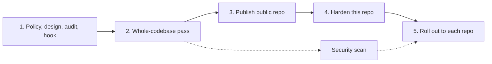

# Implementation Plan: ci-flow

## Phases

| # | Phase | Status | Gate |
|---|---|---|---|
| 1 | Single policy file, add-ons, audit, reminder hook | DONE | tests pass |
| 2 | Whole-codebase pass (audit, simplify, proofread, review) | DONE | tests pass; skip list recorded |
| 3 | Public repo, fresh single-commit history, MIT license | DONE | gitleaks clean; no private names |
| 4 | Harden this repo | IN PROGRESS | `audit.ts --config-only` |
| 5 | Roll out to each repo, most expensive first | OPEN | per-repo audit before and after |

## Open items

- **Branch protection on `main`** — OPEN, owner decision. The policy wants a PR required; that ends direct pushes to `main`.
- **Dependabot config** — TBD. The repo has no workflows or dependencies yet, so the two Dependabot checks fail with nothing to update; add when CI arrives.
- **CI for this repo** — TBD. Tests run locally only (`bun test tests/`).
- **Security scan** — OPEN. Started and stopped on 2026-11-02 for usage limits; no findings produced.
- **Parallel `gh api` reads in the audit** — deferred (async rewrite).

## Owner decisions

Recorded in [`POLICY.md` §0](../skills/ci-flow/POLICY.md).
