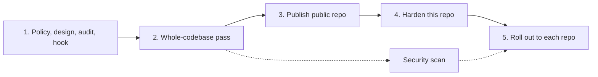

# Implementation Plan: ci-flow

## Phases

| # | Phase | Status | Gate |
|---|---|---|---|
| 1 | Single policy file, add-ons, audit, reminder hook | DONE | tests pass |
| 2 | Whole-codebase pass (audit, simplify, proofread, review) | DONE | tests pass; skip list recorded |
| 3 | Public repo, fresh single-commit history, MIT license | DONE | gitleaks clean; no private names |
| 4 | Harden this repo | IN PROGRESS | `audit.ts --config-only` |
| 5 | Roll out to each repo, most expensive first | IN PROGRESS | per-repo audit before and after |

## Open items

- **Branch protection on `main`** — DONE 2026-11-04 (owner decision): PR required with 0 approvals, admins included, linear history, no force-push or deletion. No required checks until this repo has CI.
- **Dependabot config** — TBD. The repo has no workflows or dependencies yet, so the two Dependabot checks fail with nothing to update; add when CI arrives.
- **CI for this repo** — TBD. Tests run locally only (`bun test tests/`).
- **Security scan** — DONE 2026-11-04: whole repository at `83a27c4`, medium effort, 0 findings, verified. One candidate (audited-repo text printed unchanged in the report) was rejected 3 of 3 as a false positive.
- **Parallel `gh api` reads in the audit** — deferred (async rewrite).
- **First rollout** — DONE 2026-11-04 on one private repo: 22 audit FAILs to 0 (45 pass) over two PRs; protection applied after the first merge, as the policy orders.
- **Audit reads shell comments as job content** — DONE. `runOf()` kept `#` lines in `run:` blocks, so a comment containing "e2e" made `browser-job` FAIL on a cheap job. Fixed: `runOf()` drops comment lines; test "a comment naming a tool is not a call" covers `browser-job` and `toolchain-every-job`.

## Owner decisions

Recorded in [`POLICY.md` §0](../skills/ci-flow/POLICY.md).
