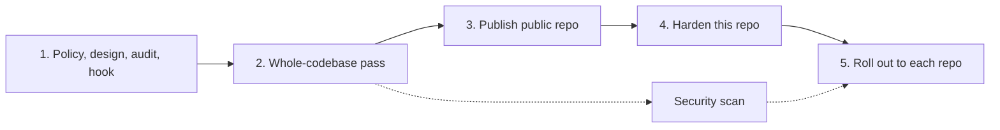

# Implementation Plan: ci-flow

## Phases

| # | Phase | Status | Gate |
|---|---|---|---|
| 1 | Single policy file, add-ons, audit, reminder hook | DONE | tests pass |
| 2 | Whole-codebase pass (audit, simplify, proofread, review) | DONE | tests pass; skip list recorded |
| 3 | Public repo, fresh single-commit history, MIT license | DONE | gitleaks clean; no private names |
| 4 | Harden this repo | DONE | `audit.ts`: 43 pass, 0 fail (2026-11-04) |
| 5 | Roll out to each repo, most expensive first | IN PROGRESS | per-repo audit before and after |

## Open items

- **Branch protection on `main`** — DONE 2026-11-04 (owner decision): PR required with 0 approvals, admins included, linear history, no force-push or deletion. Required check `checks` added after CI landed, applied by `scripts/protect-main.sh` and read back.
- **Dependabot config** — DONE 2026-11-04: github-actions, weekly, grouped (the repo has no package manifest).
- **CI for this repo** — DONE 2026-11-04: one cheap job `checks` (range gitleaks, `bun test tests/`) on every PR event and `main` push; bun pinned exactly and guarded by `tests/ci-workflow.test.ts`.
- **Security scan** — DONE 2026-11-04: whole repository at `83a27c4`, medium effort, 0 findings, verified. One candidate (audited-repo text printed unchanged in the report) was rejected 3 of 3 as a false positive.
- **Parallel `gh api` reads in the audit** — DONE 2026-11-04 (#8): the repo GETs and per-run job lists are prefetched in parallel; a full audit of this repo went from 11.4 s to 2.3 s with identical output.
- **Split `audit.ts`** — DONE 2026-11-04 (#9): `scripts/lib/` holds `gh.ts`, `plans.ts` and `owner.ts`; the checks stay in `audit.ts` (they share module state). No behaviour change.
- **GitHub shows no license** — OPEN: `LICENSE` matches GitHub's MIT template byte for byte and sits at the root of `main`, yet `licenseInfo` is null. The cause is on GitHub's side; nothing in the repo to fix.
- **Caches the default branch never writes** — DONE 2026-11-04: new audit check `cache-default-branch` and the SKILL.md rule; the first rollout repo now shows it as its one FAIL (two PR-only caches), for its own session to fix.
- **Self-audit false positives** — DONE 2026-11-04: `audit-ungated` is n.a. without a package manifest; `browser-wait-proxy` counts only files that import Playwright.
- **First rollout** — DONE 2026-11-04 on one private repo: 22 audit FAILs to 0 (45 pass) over two PRs; protection applied after the first merge, as the policy orders.
- **Audit reads shell comments as job content** — DONE. `runOf()` kept `#` lines in `run:` blocks, so a comment containing "e2e" made `browser-job` FAIL on a cheap job. Fixed: `runOf()` drops comment lines, and since #8 also trailing comments (a `#` at a word start outside quotes); tests "a comment naming a tool is not a call" cover `browser-job` and `toolchain-every-job`.

## Owner decisions

Recorded in [`POLICY.md` §0](../skills/ci-flow/POLICY.md).
