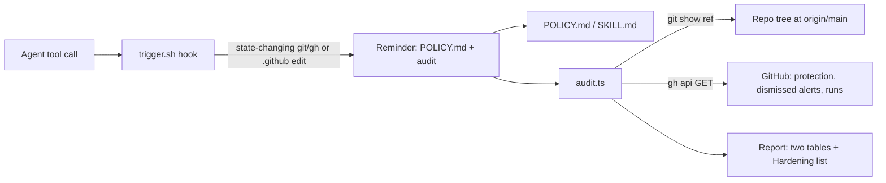

# Technical Requirements: ci-flow

## Stack

| Part | Technology | Source |
|---|---|---|
| Audit | TypeScript run by `bun` (no dependencies, no build) | `skills/ci-flow/scripts/audit.ts` |
| Reminder hook | `bash` + `jq` | `skills/ci-flow/hooks/trigger.sh` |
| Tests | `bun test` | `tests/` |
| External reads | `git show`, `gh api` (GET only) | — |

## Architecture

## Constraints

- **Read-only.** The audit writes nothing; hardening fixes are printed, never run.
- **Reads the committed tree** (`git show <ref>`, default `origin/main`), never the working tree, which may hold another session's edits.
- **Unknown is FAIL**, never PASS. Exit 0 always; `--strict` exits 1 on any FAIL (`blocked` excluded).
- **The hook never blocks**: every path exits 0. It fires once per session per repository.
- Hook markers live under `${TMPDIR:-$HOME/.cache}/ci-flow-trigger/`, created with `umask 077`; a symlinked or foreign-owned marker directory makes it remind every time instead of writing through it.
- Private folder-name prefixes, the plan and repository settings: moved to repo-create (`~/.claude/skills/repo-create/POLICY.md`; on GitHub: [kikearciniegas/repo-create](https://github.com/kikearciniegas/repo-create)).

## Performance budgets

- Hook no-op path (a command that does not fire): about 9 ms, measured 2026-11-02. It runs on every Bash/Write/Edit call, so it must stay cheap.
- Audit: the repo GETs and per-run job lists are prefetched in parallel since 2026-11-04 (#8); about 3 s for this repo (2.6–3.0 s, measured 2026-11-08), down from 11.4 s sequential.

## Quality

- Every check reported on the passing fixture has a mutation test that must flip it to FAIL; the suite fails if a check is added without one.
- Tests that spawn git strip `GIT_*` and isolate config.
- gitleaks runs on every commit (pre-commit hook).

## Integrations

- GitHub REST API via `gh` (GETs only).
- Inside a TLS-intercepting sandbox `gh` fails certificate checks; run the audit outside it.
- Claude Code `PreToolUse` hook (matcher `Bash|Write|Edit|MultiEdit`) in the user's `settings.json`.
